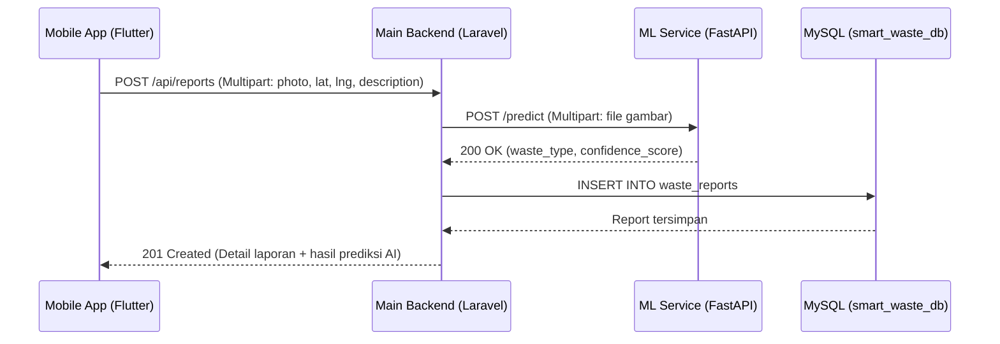

# Kontrak REST API - Smart Waste Management System

Dokumen ini mendefinisikan spesifikasi komunikasi antarlapisan pada arsitektur Monorepo **Smart Waste Management System**, yang mencakup:
1. **FastAPI ML Service (`ml-service`)**: Layanan inferensi model TensorFlow/Keras untuk klasifikasi citra sampah.
2. **Laravel Main Backend API (`web-backend`)**: Layanan utama penyedia REST API untuk aplikasi **Flutter (`mobile-app`)** sekaligus pengelola bisnis proses dan database MySQL (`smart_waste_db`).

---

## Arsitektur Alur Komunikasi



---

## Bagian 1: FastAPI ML Service (`ml-service`)

- **Base URL (Local Development):** `http://127.0.0.1:8001`
- **Format Pertukaran Data:** `multipart/form-data` (Request) & `application/json` (Response)

### 1.0. Health Check (`GET /health`)

Memeriksa kesiapan server FastAPI serta status pemuatan model `waste_classifier_model.keras`.

- **Endpoint:** `GET /health`
- **Response Sukses (`200 OK`):**
```json
{
  "status": "healthy",
  "model_loaded": true,
  "model_path": "waste_classifier_model.keras",
  "classes": ["Organic Waste", "Paper Waste", "Plastic Waste"]
}
```

### 1.1. Deteksi & Klasifikasi Gambar Sampah

Menerima unggahan citra sampah dan mengembalikan kelas sampah hasil prediksi beserta nilai `confidence_score`.

- **Endpoint:** `POST /predict`
- **Headers:**
  - `Accept: application/json`
  - `Content-Type: multipart/form-data`

#### Request Body (`multipart/form-data`)

| Field | Tipe | Wajib | Deskripsi |
| :--- | :--- | :--- | :--- |
| `file` (atau `photo`) | `File (Binary)` | Ya | File gambar sampah dengan ekstensi `.jpg`, `.jpeg`, `.png`, `.webp`, atau `.bmp` |

#### Response Sukses (`200 OK`)

```json
{
  "success": true,
  "message": "Prediction successful",
  "data": {
    "waste_type": "Plastic Waste",
    "confidence_score": 0.9642,
    "all_probabilities": {
      "Organic Waste": 0.0125,
      "Paper Waste": 0.0233,
      "Plastic Waste": 0.9642
    }
  },
  "waste_type": "Plastic Waste",
  "confidence_score": 0.9642
}
```

#### Nilai Enum `waste_type` yang Valid
- `Organic Waste`
- `Plastic Waste`
- `Paper Waste`

#### Response Error (`400 Bad Request` / `413 Payload Too Large` / `422 Unprocessable Entity`)

```json
{
  "detail": "Invalid image file format. Allowed formats: jpg, jpeg, png, webp, bmp."
}
```

Jika ukuran file gambar melebihi batas maksimal 5 MB (`413 Payload Too Large`):

```json
{
  "detail": "Uploaded file exceeds the 5 MB maximum size limit."
}
```

#### Response Error Server (`500 Internal Server Error`)

```json
{
  "detail": "Model inference failed."
}
```

---

## Bagian 2: Laravel REST API untuk Mobile Flutter (`web-backend`)

- **Base URL (Local Development):** `http://127.0.0.1:8000`
- **Prefix Endpoint:** `/api`
- **Autentikasi:** Bearer Token (Laravel Sanctum)
- **Header Standar (Semua Request):**
  - `Accept: application/json`
- **Header Tambahan (Endpoint Terproteksi):**
  - `Authorization: Bearer <access_token>`

---

### 2.1. Registrasi Pengguna Baru

Mendaftarkan akun pengguna baru dengan role default `user` dan langsung mengembalikan token akses.

- **Endpoint:** `POST /api/register`
- **Auth Required:** Tidak
- **Content-Type:** `application/json`

#### Request Body

```json
{
  "name": "Budi Santoso",
  "email": "budi@example.com",
  "password": "password123",
  "password_confirmation": "password123"
}
```

#### Aturan Validasi
- `name`: wajib, string, maksimal 255 karakter.
- `email`: wajib, format email valid, unik pada tabel `users`.
- `password`: wajib, string, minimal 6 karakter, harus cocok dengan `password_confirmation`.

#### Response Sukses (`201 Created`)

```json
{
  "success": true,
  "message": "Registrasi berhasil",
  "data": {
    "user": {
      "id": 1,
      "name": "Budi Santoso",
      "email": "budi@example.com",
      "role": "user",
      "created_at": "2026-11-01T12:00:00.000000Z"
    },
    "access_token": "1|laravel_sanctum_token_example_xyz123",
    "token_type": "Bearer"
  }
}
```

#### Response Error Validasi (`422 Unprocessable Entity`)

```json
{
  "success": false,
  "message": "Data yang diberikan tidak valid",
  "errors": {
    "email": [
      "Email sudah terdaftar."
    ]
  }
}
```

---

### 2.2. Login Pengguna

Mengautentikasi pengguna dan menerbitkan Bearer token untuk digunakan pada aplikasi Flutter.

- **Endpoint:** `POST /api/login`
- **Auth Required:** Tidak
- **Content-Type:** `application/json`

#### Request Body

```json
{
  "email": "budi@example.com",
  "password": "password123"
}
```

#### Response Sukses (`200 OK`)

```json
{
  "success": true,
  "message": "Login berhasil",
  "data": {
    "user": {
      "id": 1,
      "name": "Budi Santoso",
      "email": "budi@example.com",
      "role": "user"
    },
    "access_token": "2|laravel_sanctum_token_example_abc456",
    "token_type": "Bearer"
  }
}
```

#### Response Error Kredensial (`401 Unauthorized`)

```json
{
  "success": false,
  "message": "Email atau password salah",
  "data": null
}
```

---

### 2.2b. Logout Pengguna (`POST /api/logout`)

Menghapus token akses Sanctum yang sedang digunakan oleh pengguna.

- **Endpoint:** `POST /api/logout`
- **Auth Required:** Ya (`Bearer Token`)

#### Response Sukses (`200 OK`)

```json
{
  "success": true,
  "message": "Logout berhasil",
  "data": null
}
```

---

### 2.3. Daftar Laporan Sampah (`GET /api/reports`)

Mengambil daftar laporan sampah milik pengguna yang sedang login (atau seluruh laporan jika pengguna memiliki role `admin`). Mendukung paginasi, filter status/jenis sampah, serta pencarian kata kunci (`search`).

- **Endpoint:** `GET /api/reports`
- **Auth Required:** Ya (`Bearer Token`)

#### Query Parameters (Opsional)

| Parameter | Tipe | Default | Deskripsi |
| :--- | :--- | :--- | :--- |
| `page` | `integer` | `1` | Nomor halaman paginasi |
| `per_page` | `integer` | `10` | Jumlah item per halaman (maks `50`) |
| `status` | `string` | - | Filter status: `Pending`, `In Progress`, `Completed`, `Rejected` |
| `waste_type` | `string` | - | Filter jenis sampah: `Organic Waste`, `Plastic Waste`, `Paper Waste` |
| `search` | `string` | - | Pencarian kata kunci pada kolom `description`, `address`, `waste_type`, atau `status` |

#### Response Sukses (`200 OK`)

```json
{
  "success": true,
  "message": "Daftar laporan berhasil diambil",
  "data": [
    {
      "id": 15,
      "user_id": 1,
      "user_name": "Budi Santoso",
      "user": {
        "id": 1,
        "name": "Budi Santoso",
        "email": "budi@example.com"
      },
      "photo_path": "reports/2026/11/waste_6724c9e1.jpg",
      "photo_url": "http://127.0.0.1:8000/storage/reports/2026/11/waste_6724c9e1.jpg",
      "waste_type": "Plastic Waste",
      "confidence_score": 0.9642,
      "latitude": -6.20000000,
      "longitude": 106.81666600,
      "address": "Jl. Jenderal Sudirman No. 1, Jakarta Pusat",
      "description": "Tumpukan botol plastik di dekat halte bus.",
      "status": "Pending",
      "admin_notes": null,
      "created_at": "2026-11-01T12:30:00.000000Z",
      "updated_at": "2026-11-01T12:30:00.000000Z"
    }
  ],
  "meta": {
    "current_page": 1,
    "per_page": 10,
    "total": 1,
    "last_page": 1
  }
}
```

---

### 2.3b. Deteksi Jenis Sampah via AI Proxy (`POST /api/reports/detect`)

Menerima unggahan gambar dari aplikasi mobile, meneruskannya ke FastAPI ML Service (`POST http://127.0.0.1:8001/predict`), dan mengembalikan hasil prediksi `waste_type` serta `confidence_score` sebelum pengguna menyimpan laporan.

- **Endpoint:** `POST /api/reports/detect`
- **Auth Required:** Ya (`Bearer Token`)
- **Content-Type:** `multipart/form-data`

#### Request Body (`multipart/form-data`)

| Field | Tipe | Wajib | Aturan Validasi & Deskripsi |
| :--- | :--- | :--- | :--- |
| `photo` | `File` | Ya | Gambar (`jpg`, `jpeg`, `png`, `webp`), maks `5120` KB (5 MB) |

#### Response Sukses (`200 OK`)

```json
{
  "success": true,
  "message": "Deteksi jenis sampah berhasil",
  "data": {
    "waste_type": "Plastic Waste",
    "confidence_score": 0.9922,
    "all_probabilities": {
      "Organic Waste": 0.0012,
      "Paper Waste": 0.0066,
      "Plastic Waste": 0.9922
    }
  }
}
```

---

### 2.4. Buat Laporan Sampah Baru (`POST /api/reports`)

Mengunggah foto sampah dan informasi lokasi dari aplikasi Flutter. Backend Laravel akan menyimpan foto, mengirimkannya ke FastAPI (`POST /predict`) untuk klasifikasi otomatis, lalu menyimpan laporan ke database dengan status awal `Pending`.

- **Endpoint:** `POST /api/reports`
- **Auth Required:** Ya (`Bearer Token`)
- **Content-Type:** `multipart/form-data`

#### Request Body (`multipart/form-data`)

| Field | Tipe | Wajib | Aturan Validasi & Deskripsi |
| :--- | :--- | :--- | :--- |
| `photo` | `File` | Ya | Gambar (`jpg`, `jpeg`, `png`, `webp`), maks `5120` KB (5 MB) |
| `latitude` | `decimal` | Ya | Numerik antara `-90` hingga `90` |
| `longitude` | `decimal` | Ya | Numerik antara `-180` hingga `180` |
| `address` | `string` | Tidak | Teks alamat lokasi (nullable, maksimal `1000` karakter) |
| `description` | `string` | Ya | Deskripsi kondisi sampah di lokasi (minimal `5`, maksimal `5000` karakter) |
| `waste_type` | `string` | Tidak | Opsional (`Organic Waste`, `Plastic Waste`, `Paper Waste`). Jika kosong, otomatis diklasifikasikan melalui FastAPI |
| `confidence_score` | `float` | Tidak | Opsional (`0.0` hingga `1.0`) hasil deteksi AI sebelumnya |

#### Response Sukses (`201 Created`)

```json
{
  "success": true,
  "message": "Laporan sampah berhasil disimpan",
  "data": {
    "id": 15,
    "user_id": 1,
    "user_name": "Budi Santoso",
    "photo_path": "reports/2026/11/waste_6724c9e1.jpg",
    "photo_url": "http://127.0.0.1:8000/storage/reports/2026/11/waste_6724c9e1.jpg",
    "waste_type": "Plastic Waste",
    "confidence_score": 0.9642,
    "latitude": -6.20000000,
    "longitude": 106.81666600,
    "address": "Jl. Jenderal Sudirman No. 1, Jakarta Pusat",
    "description": "Tumpukan botol plastik di dekat halte bus.",
    "status": "Pending",
    "admin_notes": null,
    "created_at": "2026-11-01T12:30:00.000000Z",
    "updated_at": "2026-11-01T12:30:00.000000Z"
  }
}
```

#### Response Error Layanan ML Tidak Tersedia (`503 Service Unavailable`)

```json
{
  "success": false,
  "message": "Layanan deteksi AI sedang tidak dapat diakses. Silakan coba beberapa saat lagi.",
  "data": null
}
```

---

### 2.5. Detail Laporan Sampah (`GET /api/reports/{id}`)

Mengambil informasi lengkap dari satu laporan sampah berdasarkan `id`.

- **Endpoint:** `GET /api/reports/{id}`
- **Auth Required:** Ya (`Bearer Token`)

#### Path Parameters

| Parameter | Tipe | Deskripsi |
| :--- | :--- | :--- |
| `id` | `integer` | ID unik dari `waste_reports` |

#### Response Sukses (`200 OK`)

```json
{
  "success": true,
  "message": "Detail laporan berhasil diambil",
  "data": {
    "id": 15,
    "user_id": 1,
    "user_name": "Budi Santoso",
    "user": {
      "id": 1,
      "name": "Budi Santoso",
      "email": "budi@example.com"
    },
    "photo_path": "reports/2026/11/waste_6724c9e1.jpg",
    "photo_url": "http://127.0.0.1:8000/storage/reports/2026/11/waste_6724c9e1.jpg",
    "waste_type": "Plastic Waste",
    "confidence_score": 0.9642,
    "latitude": -6.20000000,
    "longitude": 106.81666600,
    "address": "Jl. Jenderal Sudirman No. 1, Jakarta Pusat",
    "description": "Tumpukan botol plastik di dekat halte bus.",
    "status": "In Progress",
    "admin_notes": "Petugas kebersihan sedang menuju lokasi.",
    "created_at": "2026-11-01T12:30:00.000000Z",
    "updated_at": "2026-11-01T13:15:00.000000Z"
  }
}
```

#### Response Error Tidak Ditemukan (`404 Not Found`)

```json
{
  "success": false,
  "message": "Laporan sampah tidak ditemukan",
  "data": null
}
```

---

### 2.5b. Hapus Laporan Sampah (`DELETE /api/reports/{id}`)

Menghapus laporan sampah berdasarkan ID:
- **Role `admin`**: Dapat menghapus laporan pada seluruh status (`Pending`, `In Progress`, `Completed`, `Rejected`).
- **Role `user` (Warga)**: Hanya dapat menghapus laporan miliknya yang masih berstatus `Pending`. Apabila laporan sudah diproses oleh admin (`In Progress`, `Completed`, atau `Rejected`), permintaan akan ditolak.

- **Endpoint:** `DELETE /api/reports/{id}`
- **Auth Required:** Ya (`Bearer Token`)

#### Response Sukses (`200 OK`)

```json
{
  "success": true,
  "message": "Laporan sampah #15 berhasil dihapus",
  "data": null
}
```

#### Response Error Status Sudah Diproses (`422 Unprocessable Entity`)

```json
{
  "success": false,
  "message": "Laporan tidak dapat dihapus karena sudah diproses oleh admin (status: In Progress).",
  "data": null
}
```

---

### 2.6. Ringkasan Dashboard (`GET /api/dashboard-summary`)

Mengambil statistik ringkasan laporan sampah untuk ditampilkan pada halaman utama (Home/Dashboard) aplikasi mobile Flutter (mencakup laporan milik pengguna yang login, atau seluruh laporan sistem jika pengguna berstatus `admin`).

- **Endpoint:** `GET /api/dashboard-summary`
- **Auth Required:** Ya (`Bearer Token`)

#### Response Sukses (`200 OK`)

```json
{
  "success": true,
  "message": "Data ringkasan dashboard berhasil diambil",
  "data": {
    "total_reports": 12,
    "status_counts": {
      "Pending": 3,
      "In Progress": 2,
      "Completed": 6,
      "Rejected": 1,
      "pending": 3,
      "in_progress": 2,
      "completed": 6,
      "rejected": 1
    },
    "waste_type_counts": {
      "Organic Waste": 4,
      "Plastic Waste": 5,
      "Paper Waste": 3,
      "organic_waste": 4,
      "plastic_waste": 5,
      "paper_waste": 3
    },
    "recent_reports": [
      {
        "id": 15,
        "photo_url": "http://127.0.0.1:8000/storage/reports/2026/11/waste_6724c9e1.jpg",
        "waste_type": "Plastic Waste",
        "confidence_score": 0.9642,
        "status": "Pending",
        "address": "Jl. Jenderal Sudirman No. 1, Jakarta Pusat",
        "created_at": "2026-11-01T12:30:00.000000Z"
      }
    ]
  }
}
```

---

## Bagian 3: Standar Kode Status HTTP

| Kode Status | Keterangan | Penggunaan |
| :--- | :--- | :--- |
| `200 OK` | Request berhasil | `GET`, `POST /api/login`, `POST /predict` |
| `201 Created` | Resource baru berhasil dibuat | `POST /api/register`, `POST /api/reports` |
| `400 Bad Request` | Format request tidak dapat diproses | File gambar rusak atau parameter salah |
| `401 Unauthorized` | Belum login atau token tidak valid | Akses endpoint terproteksi tanpa Bearer token valid |
| `403 Forbidden` | Akses ditolak | Pengguna mencoba mengakses laporan milik pengguna lain |
| `404 Not Found` | Data tidak ditemukan | ID laporan tidak ada di database |
| `413 Payload Too Large` | Ukuran file melebihi batas | Ukuran gambar melebihi 5 MB pada FastAPI `/predict` |
| `422 Unprocessable Entity` | Gagal validasi input | Field wajib kosong atau format input tidak sesuai |
| `429 Too Many Requests` | Melebihi batas rate limit | Permintaan terlalu sering pada endpoint ber-throttle |
| `500 Internal Server Error` | Kesalahan internal server | Kegagalan tak terduga pada Laravel atau FastAPI |
| `503 Service Unavailable` | Layanan eksternal mati | FastAPI ML Service tidak merespons saat pemanggilan dari Laravel |
