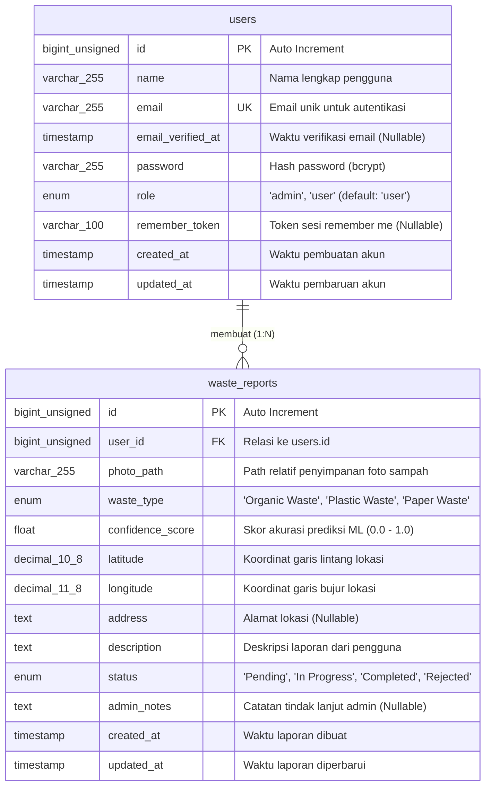

# Arsitektur & Skema Database - Smart Waste Management System

Dokumen ini mendefinisikan rancangan basis data relasional untuk **Smart Waste Management System** menggunakan **MySQL**.

## 1. Informasi Umum Database

- **DBMS:** MySQL 8.0+ / MariaDB 10.6+
- **Nama Database:** `smart_waste_db`
- **Character Set:** `utf8mb4`
- **Collation:** `utf8mb4_unicode_ci`

---

## 2. Entity Relationship Diagram (ERD)

Diagram berikut menggambarkan relasi **One-to-Many (1:N)** antara tabel `users` dan `waste_reports`, di mana satu pengguna dapat mengirimkan banyak laporan sampah.



---

## 3. Kamus Data (Data Dictionary)

### 3.1. Tabel `users`

Menyimpan data akun pengguna aplikasi mobile (pelapor) dan administrator pengelola di dashboard web.

| Nama Kolom | Tipe Data | Constraint / Atribut | Default | Deskripsi |
| :--- | :--- | :--- | :--- | :--- |
| `id` | `BIGINT UNSIGNED` | `PRIMARY KEY`, `AUTO_INCREMENT` | - | Identifier unik pengguna |
| `name` | `VARCHAR(255)` | `NOT NULL` | - | Nama lengkap pengguna |
| `email` | `VARCHAR(255)` | `NOT NULL`, `UNIQUE` | - | Alamat email untuk login |
| `email_verified_at` | `TIMESTAMP` | `NULL` | `NULL` | Waktu verifikasi email pengguna |
| `password` | `VARCHAR(255)` | `NOT NULL` | - | Password yang di-hash menggunakan Bcrypt |
| `role` | `ENUM('admin', 'user')` | `NOT NULL` | `'user'` | Peran akses pengguna dalam sistem |
| `remember_token` | `VARCHAR(100)` | `NULL` | `NULL` | Token untuk fitur *remember me* pada sesi web |
| `created_at` | `TIMESTAMP` | `NULL` | `CURRENT_TIMESTAMP` | Waktu pembuatan data |
| `updated_at` | `TIMESTAMP` | `NULL` | `CURRENT_TIMESTAMP` | Waktu terakhir data diperbarui |

### 3.2. Tabel `waste_reports`

Menyimpan data laporan temuan sampah beserta hasil klasifikasi dari layanan Machine Learning (FastAPI) dan status penanganannya.

| Nama Kolom | Tipe Data | Constraint / Atribut | Default | Deskripsi |
| :--- | :--- | :--- | :--- | :--- |
| `id` | `BIGINT UNSIGNED` | `PRIMARY KEY`, `AUTO_INCREMENT` | - | Identifier unik laporan sampah |
| `user_id` | `BIGINT UNSIGNED` | `NOT NULL`, `FOREIGN KEY (users.id)` | - | ID pengguna yang mengirim laporan |
| `photo_path` | `VARCHAR(255)` | `NOT NULL` | - | Path atau URL file gambar sampah yang diunggah |
| `waste_type` | `ENUM('Organic Waste', 'Plastic Waste', 'Paper Waste')` | `NOT NULL` | - | Hasil klasifikasi jenis sampah dari model AI |
| `confidence_score` | `FLOAT` | `NULL` | `NULL` | Nilai tingkat keyakinan model AI (rentang `0.0` hingga `1.0`) |
| `latitude` | `DECIMAL(10, 8)` | `NOT NULL` | - | Titik koordinat garis lintang (`-90.00000000` s/d `90.00000000`) |
| `longitude` | `DECIMAL(11, 8)` | `NOT NULL` | - | Titik koordinat garis bujur (`-180.00000000` s/d `180.00000000`) |
| `address` | `TEXT` | `NULL` | `NULL` | Alamat lengkap hasil reverse geocoding atau input manual |
| `description` | `TEXT` | `NOT NULL` | - | Keterangan kondisi sampah di lokasi |
| `status` | `ENUM('Pending', 'In Progress', 'Completed', 'Rejected')` | `NOT NULL` | `'Pending'` | Status penanganan laporan oleh petugas/admin |
| `admin_notes` | `TEXT` | `NULL` | `NULL` | Catatan atau alasan dari admin (misal alasan penolakan atau bukti selesai) |
| `created_at` | `TIMESTAMP` | `NULL` | `CURRENT_TIMESTAMP` | Waktu laporan dikirimkan |
| `updated_at` | `TIMESTAMP` | `NULL` | `CURRENT_TIMESTAMP` | Waktu status/data laporan terakhir diubah |

---

## 4. Skema SQL (DDL)

Skrip SQL berikut dapat dijalankan langsung pada MySQL untuk membuat database `smart_waste_db` beserta tabel dan indeksnya:

```sql
-- Buat database jika belum ada
CREATE DATABASE IF NOT EXISTS `smart_waste_db`
  CHARACTER SET utf8mb4
  COLLATE utf8mb4_unicode_ci;

USE `smart_waste_db`;

-- ==========================================
-- 1. Tabel: users
-- ==========================================
CREATE TABLE IF NOT EXISTS `users` (
    `id` BIGINT UNSIGNED NOT NULL AUTO_INCREMENT,
    `name` VARCHAR(255) NOT NULL,
    `email` VARCHAR(255) NOT NULL,
    `email_verified_at` TIMESTAMP NULL DEFAULT NULL,
    `password` VARCHAR(255) NOT NULL,
    `role` ENUM('admin', 'user') NOT NULL DEFAULT 'user',
    `remember_token` VARCHAR(100) NULL DEFAULT NULL,
    `created_at` TIMESTAMP NULL DEFAULT CURRENT_TIMESTAMP,
    `updated_at` TIMESTAMP NULL DEFAULT CURRENT_TIMESTAMP ON UPDATE CURRENT_TIMESTAMP,
    PRIMARY KEY (`id`),
    UNIQUE KEY `users_email_unique` (`email`),
    KEY `users_role_index` (`role`)
) ENGINE=InnoDB DEFAULT CHARSET=utf8mb4 COLLATE=utf8mb4_unicode_ci;

-- ==========================================
-- 2. Tabel: waste_reports
-- ==========================================
CREATE TABLE IF NOT EXISTS `waste_reports` (
    `id` BIGINT UNSIGNED NOT NULL AUTO_INCREMENT,
    `user_id` BIGINT UNSIGNED NOT NULL,
    `photo_path` VARCHAR(255) NOT NULL,
    `waste_type` ENUM('Organic Waste', 'Plastic Waste', 'Paper Waste') NOT NULL,
    `confidence_score` FLOAT NULL,
    `latitude` DECIMAL(10, 8) NOT NULL,
    `longitude` DECIMAL(11, 8) NOT NULL,
    `address` TEXT NULL,
    `description` TEXT NOT NULL,
    `status` ENUM('Pending', 'In Progress', 'Completed', 'Rejected') NOT NULL DEFAULT 'Pending',
    `admin_notes` TEXT NULL,
    `created_at` TIMESTAMP NULL DEFAULT CURRENT_TIMESTAMP,
    `updated_at` TIMESTAMP NULL DEFAULT CURRENT_TIMESTAMP ON UPDATE CURRENT_TIMESTAMP,
    PRIMARY KEY (`id`),
    KEY `waste_reports_user_id_foreign` (`user_id`),
    KEY `waste_reports_status_index` (`status`),
    KEY `waste_reports_waste_type_index` (`waste_type`),
    KEY `waste_reports_created_at_index` (`created_at`),
    CONSTRAINT `waste_reports_user_id_foreign`
        FOREIGN KEY (`user_id`) REFERENCES `users` (`id`)
        ON DELETE CASCADE
        ON UPDATE CASCADE
) ENGINE=InnoDB DEFAULT CHARSET=utf8mb4 COLLATE=utf8mb4_unicode_ci;
```

---

## 5. Catatan Implementasi Laravel (Migrations)

Saat mengimplementasikan skema di atas pada folder `web-backend` (Laravel), pastikan aturan berikut diterapkan:
1. Gunakan `foreignId('user_id')->constrained('users')->cascadeOnDelete()` pada migration `create_waste_reports_table`.
2. Gunakan presisi `decimal('latitude', 10, 8)` dan `decimal('longitude', 11, 8)` agar kompatibel dengan koordinat GPS standar perangkat mobile.
3. Untuk autentikasi API Mobile Flutter, Laravel Sanctum akan menambahkan tabel pendukung bawaan (`personal_access_tokens`) saat proses inisialisasi backend.
